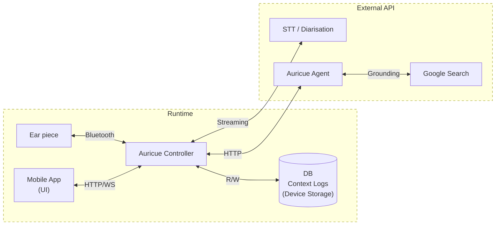
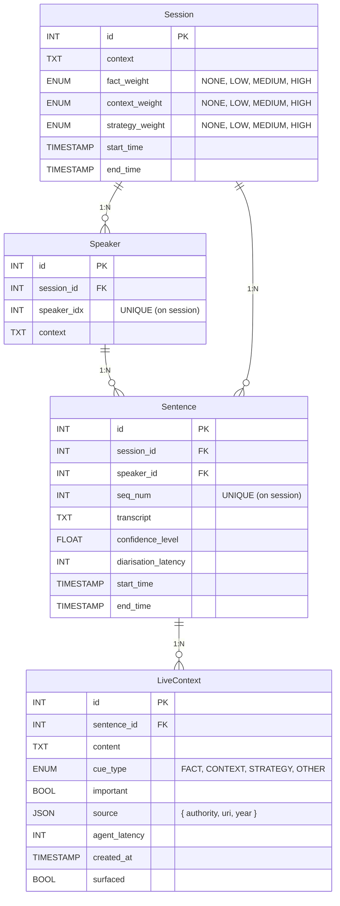

# Design/Technical Specification

## Scoping
### Problem Formulation
Auricue's solution simultaneously tackles 3 out of the 5 tracks suggested in
the problem statement:

- A. Accessibility: making voice tech more inclusive for differently-abled
    communities.
- B. Productivity: streamlining workflows with Voice AI automation
- E. Real-Time Assistance: coaching, transcription, translation and more

### Stakeholders
The end user engaged in a conversation and requiring contextual assistance.
Has access to conversational data and simultaneously providing consent to
operate on it.
All data is stored locally and only accessable by the user.

### Scoping
- Personal context and conversation transcripts stored locally under DB.
- Real-time search engine/fact checker component for contextual cues.
- Transcription, speaker diarisation and accuracy/fidelity API.
- Mobile UI for viewing data/logs

### Constraints
- Latency requirements, <2000 ms E2E is a must factor.
- Minimise bandwidth and unnecessary IO due to connection stability
- Privacy/consent factor, must require user authorisation
- Localisation: Support only English/derivatives for MVP.

## Process/Data Flow Diagram


## Entity-Relational Mapping


## Internal Protocol

### REST Endpoints
REST endpoints and schemas are defined in [openapi.yml](openapi.yml).

### WebSockets
- Endpoint: `WS /api/session`

Bidirectional channel between UI and Controller for session orchestration and real-time streaming:

#### Client -> Server Actions
- `start`: Begin audio streaming and processing for a new session.
  ```json
  { "action": "start" }
  ```
- `stop`: Signal end of audio, flush final context summary, and close session.
  ```json
  { "action": "stop" }
  ```

#### Server -> Client Events
- `status`: Pipeline status update.
  ```json
  { "type": "status", "running": true, "session_id": 1 }
  ```
- `sentence`: Live diarised transcript utterance with perceived STT latency.
  ```json
  {
    "type": "sentence",
    "seq_num": 1,
    "speaker_idx": 0,
    "transcript": "Did you know Henry?",
    "confidence": 0.95,
    "diarisation_latency": 410,
    "start_time": "2026-11-03T01:00:00Z",
    "end_time": "2026-11-03T01:00:02Z"
  }
  ```
- `cue`: Generated real-time contextual assistance cue.
  ```json
  {
    "type": "cue",
    "sentence_id": 1,
    "cue_type": "FACT",
    "content": "Not visible from the Moon with the naked eye.",
    "important": false,
    "surfaced": true,
    "source": { "authority": "NASA", "uri": "https://...", "year": 2005 },
    "agent_latency": 580
  }
  ```
- `context`: Rolling or final compacted session summary and speaker profiles.
  ```json
  {
    "type": "context",
    "context": "Discussion on misconceptions.",
    "speakers": [{ "speaker_idx": 0, "context": "Challenged common myth." }]
  }
  ```
- `weights`: Broadcast of active sensitivity weights.
  ```json
  { "type": "weights", "weights": { "FACT": "MEDIUM", "CONTEXT": "MEDIUM", "STRATEGY": "HIGH" } }
  ```
