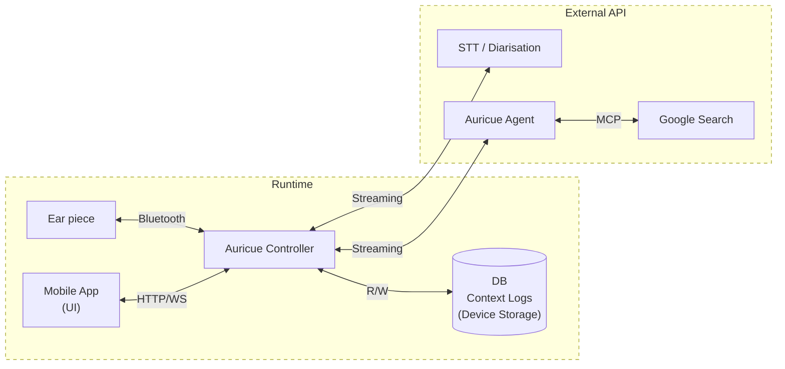

# Design/Technical Specification

## Scoping
### Problem Formulation
Auricue's solution simultaneously tackles 3 out of the 5 tracks suggested in
the problem statement:

- A. Accessibility: making voice tech more inclusive for differently-abled
    communities.
- B. Productivity: streamlining workflows with Voice AI automation
- E. Real-Time Assistance: coaching, transcription, translation and more

### Stakeholders
The end user engaged in a conversation and requiring contextual assistance.
All data is stored locally and only accessable by the user.

### Scoping
- Personal context and conversation transcripts stored locally under DB.
- Real-time search engine/fact checker component for contextual cues.
- Transcription, speaker diarisation and accuracy/fidelity API.
- Mobile UI for viewing data/logs

### Constraints
- Latency requirements, <2000 ms E2E is a must factor.
- Minimise bandwidth and unnecessary IO due to connection stability
- Privacy/consent factor, must require user authorisation
- Localisation: Support only English/derivatives for MVP.

## Process/Data Flow Diagram

## Relational Mapping
TBD
